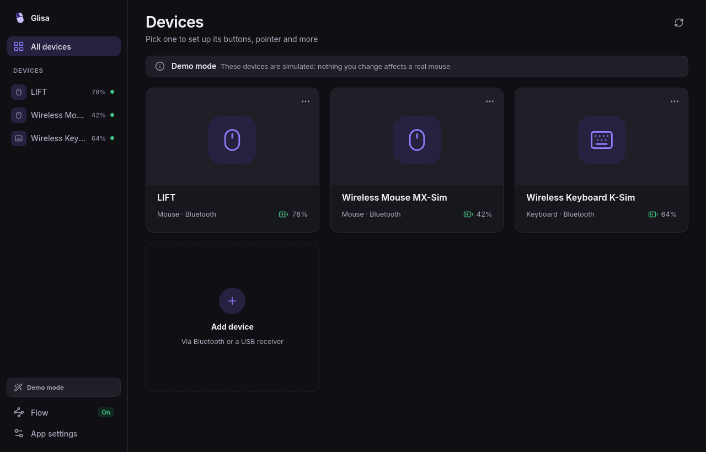
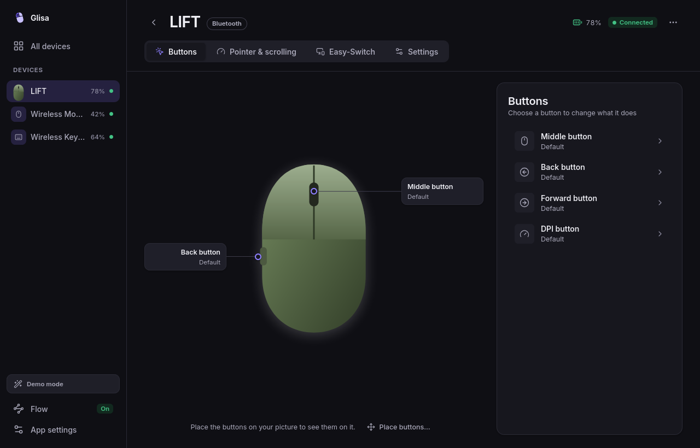
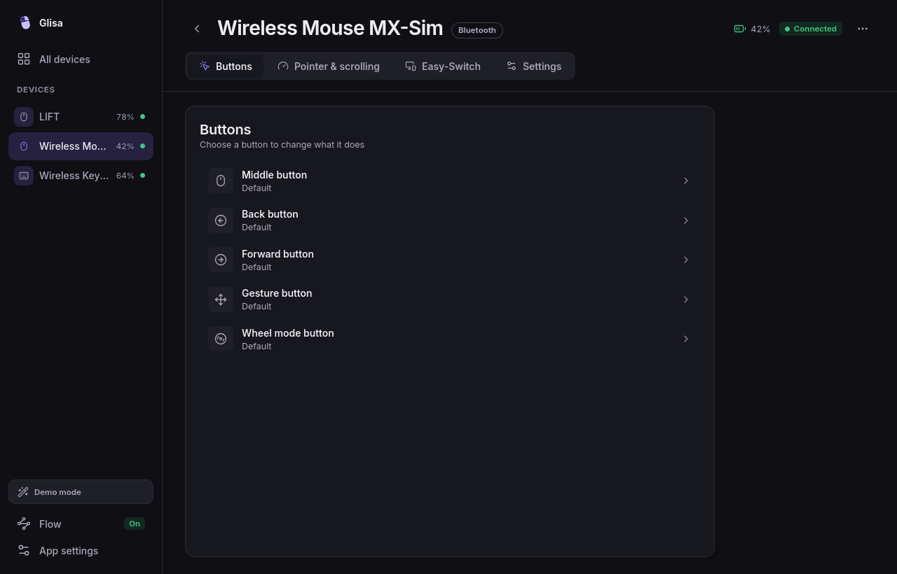
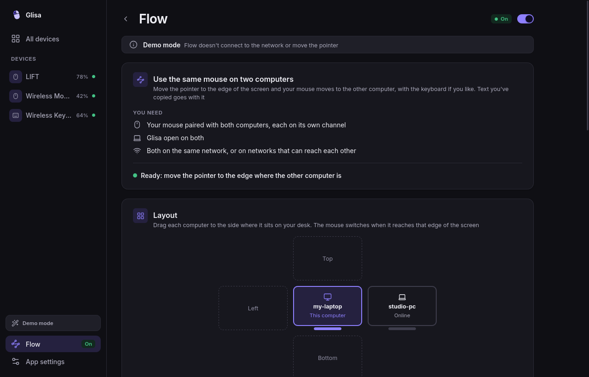
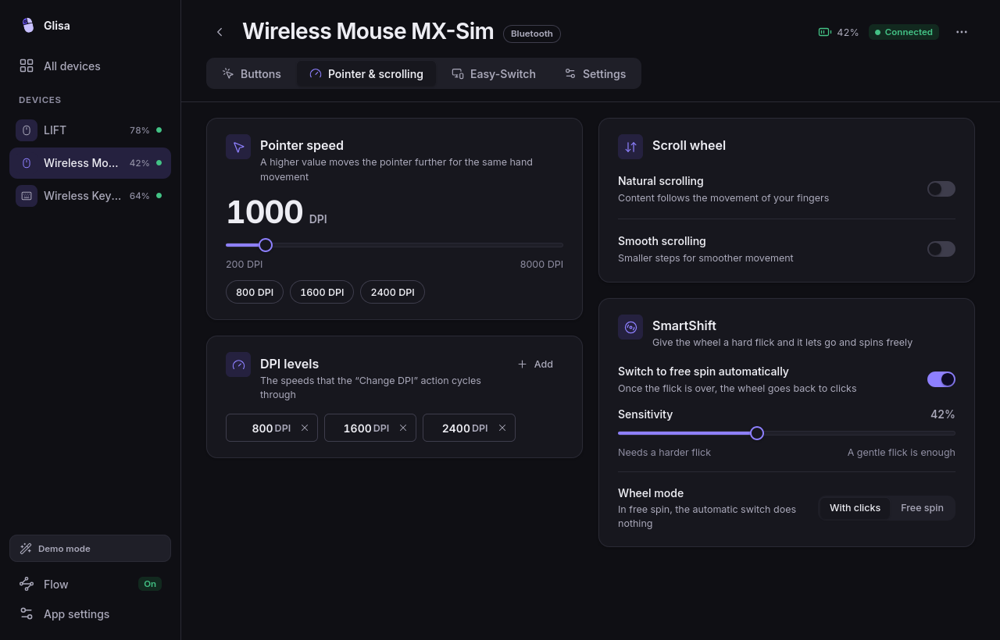
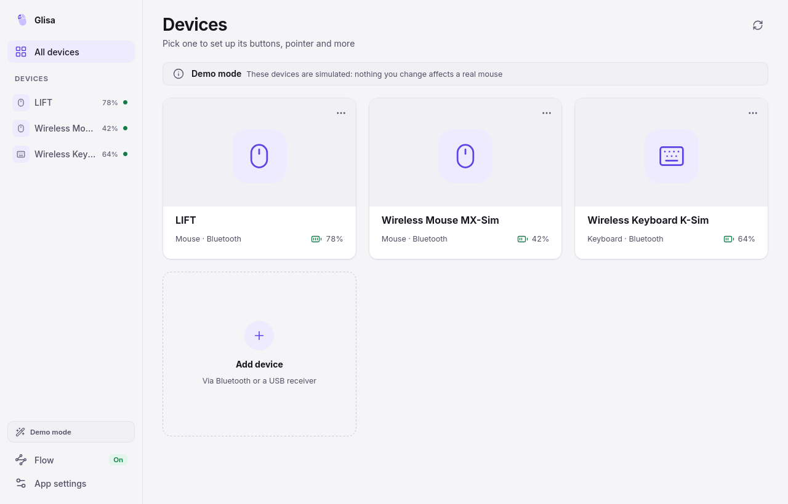

<div align="center">


**Set up your Logitech mouse and keyboard your way, on Linux, Windows and macOS.**


</div>

Glisa remaps buttons and gestures, tunes pointer speed and scrolling, switches Easy-Switch
channels and moves one mouse between your computers with **Flow**: copied text, files, folders
and images travel with it. It talks the devices' own **HID++ 2.0** protocol directly, runs your
button actions in the background, and is one small download with nothing else to install.

It is an independent, open-source project. It contains no Logitech code, images or data, and
it is not affiliated with Logitech.

Available in **English** and **Spanish**. It follows your system language, or pick one in
*App settings → Language*.

---

## Contents

- [Screenshots](#screenshots) · [Features](#features) · [Download and install](#download-and-install)
- [Compatibility](#compatibility)
- [Using Glisa](#using-glisa) · [Flow](#flow-one-mouse-several-computers)
- [Files and privacy](#files-and-privacy) · [Security](#security)
- [Building from source](#building-from-source) · [Roadmap](#roadmap) · [License](#license)

## Screenshots

| | |
|---|---|
|  |  |
| *Your devices, with battery and connection at a glance* | *Buttons placed on the device's photo* |
|  |  |
| *Or simply the list of its buttons* | *Flow: arrange your computers and cross the edge* |
|  |  |
| *Pointer speed, wheel and SmartShift* | *Light and dark themes* |

## Features

- **Buttons and gestures.** Assign any button the device lets you divert:
  - mouse clicks and horizontal scroll;
  - keyboard shortcuts (recorded by pressing them);
  - commands, media, window and desktop actions;
  - browser shortcuts;
  - a DPI cycle;
  - a gesture button with five directions.

  The presets match your system: Win+Tab on Windows, Mission Control on macOS, KDE and
  GNOME shortcuts on Linux.
- **Pointer and scrolling.** DPI with your own presets, hi-res wheel, scroll direction, and
  SmartShift ratchet/free-spin with its threshold.
- **Easy-Switch.** See the computers paired on each channel and switch from the window.
- **Product photos, or a clean list.** Turn on *Show product photos* to see each device's
  official photo (downloaded from logitech.com on your computer), and place its buttons on
  it once in an editor. Or use a photo of your own, from a file or a link. Without a photo,
  the Buttons page is a plain list of the device's buttons.
- **Flow.** Move one mouse (and its keyboard) between computers by pushing the pointer past
  the screen edge:
  - copied text, files, folders and images follow;
  - drag files to the edge and drop them on the other computer in one gesture (KDE Plasma):
    the edges that lead to your other computers glow softly while you hold them;
  - end-to-end encrypted with pinned keys;
- **Background service and tray.** Settings come back on their own when a device reconnects.
  Low-battery notifications. Starts at login. The window only uses memory while it is open.
- **Command line.** `glisa ctl` does everything the window does (handy over SSH and in scripts).

## Download and install

Download the installer for your system from the
[Releases](https://github.com/Ignacio-Aranda/glisa/releases) page.

| System | File | Install |
|---|---|---|
| Ubuntu, Debian, Mint, Pop!_OS… | `Glisa_x.y.z_amd64.deb` | Open it, or `sudo apt install ./Glisa_*.deb`. The device permissions are installed with it: nothing else to set up. |
| Fedora, openSUSE… | `Glisa-x.y.z-1.x86_64.rpm` | `sudo dnf install ./Glisa-*.rpm` (same as above). |
| Any Linux | `Glisa_x.y.z_amd64.AppImage` | Make it executable and open it. On the first start Glisa asks for your password once to grant access to Logitech devices. |
| Windows 10/11 | `Glisa_x.y.z_x64-setup.exe` (or `.msi`) | Run the installer. The builds aren't code-signed yet: if Windows shows "Windows protected your PC", choose *More info → Run anyway*. |
| macOS 11+ (Intel and Apple Silicon) | `Glisa_x.y.z_universal.dmg` | Drag Glisa to Applications. The builds aren't notarized yet: the first time macOS refuses to open it, go to *System Settings → Privacy & Security* and choose *Open Anyway*. Glisa then asks for **Accessibility** and **Input Monitoring** (and **Local Network** for Flow); the window shows each one with a button to the right System Settings pane. |

Glisa starts at login in the tray. Closing the window keeps your buttons working; *Quit*
from the tray stops it.

## Compatibility

| | Status |
|---|---|
| Logitech **LIFT** over Bluetooth on Ubuntu 26.04, KDE Plasma 6 (Wayland) | Tested on real hardware |
| Other **HID++ 2.0** mice and keyboards over Bluetooth: MX Master, MX Anywhere, MX Vertical, MX Ergo, MX Keys, Signature, POP, ERGO K860… | Expected to work. Glisa shows whatever each device reports, so unknown models work too. |
| Devices behind **Unifying**, **Bolt** and **Lightspeed** receivers | Expected to work, not yet verified |
| Other Linux distributions, X11 sessions | Expected to work |
| **Windows 10/11**, **macOS 11+** | Built and type-checked; not yet tested on real hardware *(help wanted)* |

Flow edge detection is available on KDE Plasma 6 (Wayland), any X11 session, Windows and
macOS. Other Wayland desktops (GNOME…) don't let apps follow the pointer.

HID++ features used: name and type `0x0005`, firmware `0x0003`, battery `0x1004`/`0x1000`,
reprogrammable controls `0x1B04`, DPI `0x2201`, hi-res wheel `0x2121`, SmartShift
`0x2110`/`0x2111`, change host and hosts info `0x1814`/`0x1815`, wireless status `0x1D4B`.
HID++ 1.0 devices aren't supported.

## Using Glisa

Open Glisa from your apps menu or its tray icon, pick a device and choose what each button
does. Changes apply at once and are saved per device.

The same from a terminal, with `glisa ctl` (the `.deb` and `.rpm` also install it as
`glisa-ctl`):

```bash
glisa ctl list
```
```bash
glisa ctl button 0x53 '{"type":"keys","combo":"Ctrl+C"}'
```
```bash
glisa ctl dpi 1600
```
```bash
glisa ctl probe
```

`probe` talks to the hardware directly, without the service: please include its output when
reporting a device. Where `glisa` isn't on your `PATH`:

| Installed from | Command |
|---|---|
| AppImage | `./Glisa_*.AppImage ctl probe` |
| Windows | `"%LOCALAPPDATA%\Glisa\glisa.exe" ctl probe` (or `C:\Program Files\Glisa\glisa.exe` with the `.msi`) |
| macOS | `/Applications/Glisa.app/Contents/MacOS/glisa ctl probe` |

## Flow (one mouse, several computers)

*Beta.* Glisa runs on each computer, on the same network or on networks that
can reach each other. The device is paired with each computer on a different Easy-Switch
channel.

1. Turn **Flow** on in both windows.
2. On one computer choose *Pair a computer* and pick the other one, or *Pair by address*
   across subnets. Both screens show the **same six-digit code**: confirm it on both.
3. Drag the other computer to the side where it sits on your desk, and check the channel
   suggested for each device.
4. Push the pointer past that edge. The mouse (and optionally the keyboard) switches within
   1–3 s, with the pointer at the matching height.
5. Copy text, files, folders or an image (a screenshot too), cross, and paste with Ctrl+V on
   the other computer.
6. **Or drag them** (KDE Plasma on Wayland). Pick up files and the edges that lead to your
   other computers glow; drag them past that edge without letting go, and keep dragging on
   the other computer: drop them in any folder (they're copied). If you let go on the way,
   they're on the other computer's clipboard instead: paste with Ctrl+V.

Options: switch only while holding Ctrl, keyboard follows the mouse, share the clipboard,
bring copied files and images along (up to 2 GB by default, images up to 50 MB), drag files
across the edge. Apart from that file drag, Flow never switches while a mouse button is held,
so dragging a window or a selection to the edge doesn't drop it there.

| | |
|---|---|
| Transport | **TLS 1.3 only**, mutual authentication, an ECDSA P-256 identity per computer, peers pinned by the SHA-256 of their public key and checked on every connection. No session resumption. |
| Pairing | Commit-then-reveal and a 6-digit code confirmed on both computers, which detects a man in the middle. Time-limited, with limited attempts. |
| Received files | Separate encrypted connection per transfer, SHA-256 per file, strict path and size checks. Names are made safe for the receiving system, and nothing is overwritten. Files are kept in a private folder, never opened or run, marked as downloaded (Mark of the Web on Windows, quarantine on macOS), and cleaned up after a day. |
| Ports | UDP 27461 (discovery), TCP 27461 (computers and transfers), TCP 27462 (only while pairing). With `ufw`: `sudo ufw allow 27461/udp && sudo ufw allow 27461:27462/tcp`. Windows asks once to allow them. |

Logitech's own Flow (Options+) uses a closed protocol tied to their devices' keys, so Glisa
can't pair with it. Protocol, threat model and test plan: [docs/FLOW.md](docs/FLOW.md).

## Files and privacy

| | Linux | Windows | macOS |
|---|---|---|---|
| Settings, Flow identity | `~/.config/glisa` | `%APPDATA%\Glisa` | `~/Library/Application Support/Glisa` |
| Cache (received files, photos) | `~/.cache/glisa` | `%LOCALAPPDATA%\Glisa\cache` | `~/Library/Caches/Glisa` |
| Local control socket | `$XDG_RUNTIME_DIR/glisa.sock` | named pipe, your user only | private folder in `$TMPDIR` |

No telemetry, no accounts, no cloud. Glisa uses the network only for:
- Flow, on your network, with the computers you paired;
- a picture link you paste;
- official product photos, if you turn that option on, downloaded from `resource.logitech.com`.

## Security

- **No privileged process at runtime.** On Linux, the only privileged step is the udev rule
  that grants your session access to Logitech devices. The packages install it; the AppImage
  asks once through polkit, and the rule text travels inside the request and is checked to
  grant nothing but `uaccess`.
- **Local control** is open only to your user: a 0600 socket with a peer check, or a named
  pipe with an owner-only ACL and remote clients refused.
- **Untrusted input is bounded and validated:**
  - pictures are decoded with limits and re-encoded;
  - links must be https and must not point to this computer or the local network;
  - HID reports, discovery packets and settings files are checked.
- **Flow:** see the table above.

Accepted risks and how to report a vulnerability: [SECURITY.md](SECURITY.md).

## Building from source

You need Rust (stable), Node.js 22 and, on Linux, the WebKitGTK development packages:

```bash
sudo apt install build-essential pkg-config libwebkit2gtk-4.1-dev libayatana-appindicator3-dev librsvg2-dev libxdo-dev
```

Then, from the repository:

```bash
cd app && npm ci && npx tauri build
```

The installers land in `target/release/bundle/` (`deb/`, `rpm/`, `appimage/`; `nsis/` and
`msi/` on Windows; `dmg/` on macOS). Run without installing:

```bash
cd app && npx tauri dev -- -- --simulate
```

`--simulate` adds three simulated devices, so you can try everything without hardware.

| Path | What it is |
|---|---|
| `crates/hidpp` | HID++ 2.0 protocol, features, device simulator |
| `crates/hid` | HID access: Linux hidraw (no libudev), Windows and macOS through hidapi |
| `crates/input` | Virtual input: uinput, SendInput, CGEvent |
| `crates/service` | Device manager, settings, actions, JSON API, local IPC |
| `crates/flow` | Flow: protocol, TLS, pairing, discovery, transfers, desktop backends |
| `crates/ctl` | `glisa-ctl` |
| `crates/i18n`, `locale/` | Translations (gettext `.po`, English source) |
| `app/` | The window (Svelte 5 + TypeScript) and `app/src-tauri/` (tray, window, installers) |
| `brand/` | Logo, icons, banner and their generators |
| `docs/ARCHITECTURE.md` | How the pieces fit, contracts between them |

Checks (CI runs the same):

```bash
cargo fmt --all --check && cargo clippy --workspace --all-targets -- -D warnings && cargo test --workspace
```
```bash
cd app && npm run check && npm test && node scripts/i18n.mjs check
```

The window also runs in a normal browser against a built-in mock of the service
(`npm run dev`, then open http://localhost:1420/?mock=…). That's how its tests and the
screenshots are made (`npm run screenshots`). See [CONTRIBUTING.md](CONTRIBUTING.md).

## Roadmap

See [docs/ROADMAP.md](docs/ROADMAP.md). Next:
- testing on Windows and macOS hardware;
- dragging files across the edge on X11, Windows and macOS ([notes](docs/FLOW-DRAG-DROP.md));
- LIFT's virtual thumb wheel;
- per-application profiles.

## License

[GPL-3.0-or-later](LICENSE).

Glisa is an independent project, not affiliated with, endorsed or sponsored by Logitech.
"Logitech", "Logi Options+", "Flow", "Easy-Switch", "SmartShift", "LIFT", "MX" and related
names are trademarks of their respective owners and are used here only to describe
compatibility.
